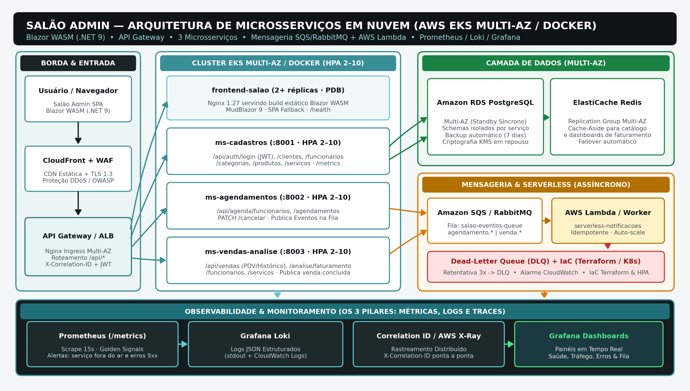

# 1. Arquitetura da solução

O diagrama também está em [`diagrama-arquitetura.mmd`](./diagrama-arquitetura.mmd) (formato Mermaid, que o GitHub desenha sozinho).

## 1. A aplicação

O **Salão Admin** é um painel para gestão de salão de beleza, feito em **Blazor WebAssembly (.NET 9)** com **MudBlazor 9**, **FluentValidation 12** e login com **JWT**.

O frontend chama sempre o endereço `/api/` (configurado em `wwwroot/appsettings.json`). Dividimos essas rotas em três microsserviços, um para cada parte do negócio:

| Parte do sistema | Rotas chamadas pelo frontend | Microsserviço |
| :--- | :--- | :--- |
| Login e cadastros (clientes, funcionários, categorias, produtos e serviços) | `POST /api/auth/login` e as rotas `/api/clientes`, `/api/funcionarios`, `/api/categorias`, `/api/produtos`, `/api/servicos` | `ms-cadastros` |
| Agenda e agendamentos | `/api/agenda/funcionarios/{id}`, `/api/agendamentos`, `PATCH /api/agendamentos/{id}/cancelar` | `ms-agendamentos` |
| Vendas (PDV), histórico e indicadores | `/api/vendas`, `/api/analise/faturamento`, `/api/analise/funcionarios`, `/api/analise/servicos` | `ms-vendas-analise` |
| Notificações | Eventos `agendamento.criado`, `agendamento.cancelado` e `venda.concluida` | `serverless-notificacoes` (função serverless) |

## 2. Ambientes

A estrutura é a mesma nos dois ambientes; muda só o serviço usado em cada peça.

| Peça | Demonstração (Docker Compose na EC2) | Produção (AWS, pelo Terraform) |
| :--- | :--- | :--- |
| Entrada | Nginx como API Gateway, porta 8080 | Application Load Balancer (Ingress do EKS) |
| Frontend e microsserviços | Contêineres Docker | Pods no Amazon EKS, em 3 zonas de disponibilidade |
| Fila de eventos | RabbitMQ | Amazon SQS + fila de erros (DLQ) |
| Função serverless | Contêiner `serverless-notificacoes` | AWS Lambda acionada pelo SQS |
| Banco e cache | PostgreSQL e Redis | Amazon RDS PostgreSQL Multi-AZ e ElastiCache Redis |
| Monitoramento | Prometheus, Loki e Grafana | Os mesmos + CloudWatch (logs da Lambda e alarme da DLQ) |

A demonstração roda numa EC2 `t3.micro` do AWS Academy (detalhes no [README principal](../README.md)). O laboratório não permite criar EKS, RDS e Lambda com perfis próprios, então o ambiente de produção fica descrito no Terraform e nos manifestos Kubernetes.

## 3. Fluxos

### 3.1 Fluxo síncrono (o usuário espera a resposta)

1. O usuário abre o sistema no navegador. O Nginx entrega o site Blazor.
2. No login (`POST /api/auth/login`), o `ms-cadastros` devolve um token JWT.
3. As próximas chamadas levam `Authorization: Bearer <token>`, colocado pelo `AuthHttpMessageHandler` do frontend.
4. O API Gateway cria um `X-Correlation-ID` para cada requisição e encaminha pelo começo da rota (`/api/clientes`, `/api/agendamentos`, `/api/vendas` etc.) para o microsserviço certo.
5. O microsserviço responde no formato que o frontend espera: `{ "sucesso", "mensagem", "erros", "dados" }`.

### 3.2 Fluxo assíncrono (fila e função serverless)

1. Ao criar ou cancelar um agendamento, ou ao concluir uma venda, o microsserviço responde ao usuário e publica um evento em JSON com `event_id`, `event_type`, `correlation_id` e os dados do registro.
2. A função de notificações recebe o evento, ignora eventos repetidos (pelo `event_id`), executa a ação (lembrete, aviso de cancelamento ou comprovante) e grava um log com o mesmo `correlation_id`.
3. Na AWS, o SQS tenta entregar a mensagem até 3 vezes (`maxReceiveCount = 3`). Se falhar nas 3, ela vai para a DLQ e um alarme do CloudWatch avisa. A Lambda devolve `batchItemFailures` para que só as mensagens com erro voltem para a fila.

## 4. Alta disponibilidade e escalabilidade (ambiente AWS)

| Camada | Se algo falhar | Se o acesso aumentar |
| :--- | :--- | :--- |
| Rede | VPC em 3 zonas de disponibilidade, um NAT Gateway por zona e ALB nas 3 zonas. | O ALB distribui o tráfego entre os pods. |
| Frontend e microsserviços | No mínimo 2 réplicas de cada serviço, distribuídas entre zonas (`topologySpreadConstraints`), testes de saúde em `/health` e `/ready` e `PodDisruptionBudget` (`minAvailable: 1`). | `HorizontalPodAutoscaler` de 2 a 10 pods quando a CPU passa de 70%. Os nós do EKS vão de 3 a 9. |
| Fila e função | O SQS guarda as mensagens em várias zonas; falhas repetidas vão para a DLQ. | A Lambda aumenta o número de execuções conforme a fila cresce. |
| Banco e cache | RDS PostgreSQL Multi-AZ, com troca automática para a réplica reserva (cerca de 1 minuto) e backup de 7 dias. Redis com réplica e failover automático. | O Redis atende as leituras repetidas e reduz a carga no banco. |

Na demonstração há uma única EC2, sem redundância. Lá, cada contêiner tem `healthcheck` e `restart: unless-stopped`, então o Docker reinicia o serviço que cair.

## 5. Monitoramento e observabilidade

1. **Métricas (Prometheus e Grafana)**
   - Os três microsserviços e a função expõem `/metrics` no formato do Prometheus, que coleta a cada 15 segundos.
   - Métricas: `http_requests_total` (por serviço, método, rota e status), `http_request_duration_ms_sum` e `_count` (tempo médio de resposta), `messaging_events_published_total` e `serverless_events_processed_total`.
   - Alertas em [`4-logs-observabilidade/prometheus/alerts.yml`](../4-logs-observabilidade/prometheus/alerts.yml): serviço fora do ar por mais de 1 minuto (`up == 0`) e mais de 5% de erros 5xx em 5 minutos.
   - O Grafana sobe com os datasources e o dashboard já configurados (pasta `5-dashboard-monitoramento`).
2. **Logs (JSON, Loki e CloudWatch)**
   - Todos os serviços escrevem logs em JSON na saída padrão, com `timestamp`, `level`, `service`, `correlation_id`, `method`, `path`, `status_code` e `latency_ms`. O Nginx também grava o acesso em JSON.
   - Na demonstração os logs são lidos com `docker compose logs`. O Loki já está no Compose e no Grafana para centralizar os logs; falta só o coletor (Promtail) para enviar os logs dos contêineres até ele. Na AWS, os logs da Lambda vão para o CloudWatch Logs (`observability.tf`).
3. **Rastreio (correlation ID)**
   - O API Gateway gera o `X-Correlation-ID`, o microsserviço registra esse ID no log e o coloca no evento, e a função grava o mesmo ID ao processar. Com um ID dá para seguir um pedido do começo ao fim. Na AWS, a Lambda também tem o X-Ray ativo.
