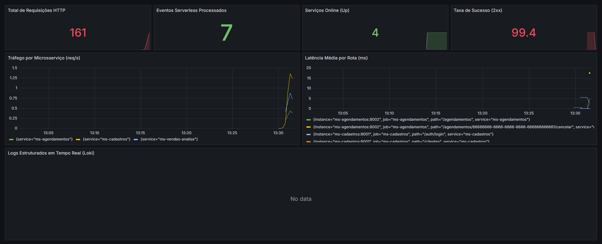

# 5 — Dashboard de monitoramento



Print do Grafana rodando na instância EC2 da AWS, tirado logo depois de usar o sistema pelo navegador. No print aparecem:

- o total de requisições HTTP e a taxa de sucesso (respostas 2xx);
- quantos eventos a função de notificações processou;
- quantos serviços estão no ar, segundo o Prometheus;
- o tráfego por microsserviço e o tempo médio de resposta por rota.

O painel de logs aparece vazio porque o ambiente da demonstração não tem o coletor (Promtail) mandando os logs dos contêineres para o Loki. Na demonstração, os logs são lidos com `docker compose logs` (veja a pasta 4).

## Como abrir

```bash
cd 3-infraestrutura-iac
docker compose up -d --build
```

1. Acesse `http://<IP-DA-MAQUINA>:3000`. Usuário e senha iniciais: `admin` / `admin`. O Grafana pede para trocar a senha no primeiro acesso.
2. As fontes de dados (Prometheus e Loki) e o dashboard `grafana/dashboards/salao-observabilidade.json` já sobem configurados.
3. Use o sistema na porta `8080` e os gráficos se atualizam a cada 10 segundos.
