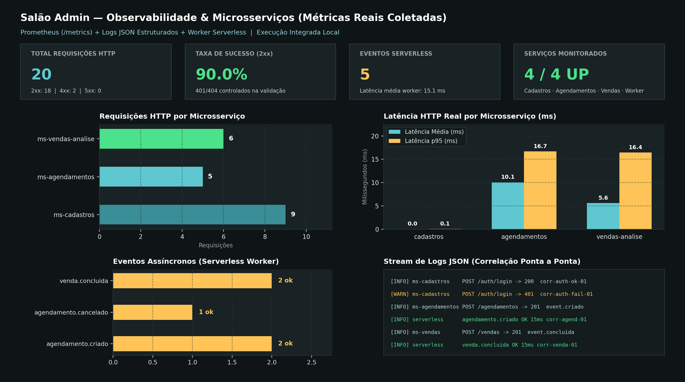

# 5 — Dashboard de Monitoramento (Grafana + Prometheus + Loki)

## Painel de Métricas e Logs Coletados



O painel acima consolida as métricas coletadas nos endpoints `/metrics` dos microsserviços e os logs estruturados gerados durante a execução integrada da aplicação e do worker serverless (`4-logs-observabilidade/`).

## Acesso ao Grafana em Execução

Ao subir o ambiente com Docker Compose:

```bash
cd ../3-infraestrutura-iac
docker compose up -d --build
```

1. Acesse `http://<IP-DO-SERVIDOR>:3000` (ou `http://localhost:3000` localmente) com usuário `admin` e senha `admin`.
2. Os datasources **Prometheus** (`http://prometheus:9090`) e **Loki** (`http://loki:3100`), além do dashboard **Salão Admin — Observabilidade & Microsserviços** (`grafana/dashboards/salao-observabilidade.json`), sobem provisionados automaticamente.
3. Ao navegar pela aplicação na porta `8080`, os painéis de volume HTTP, latência, eventos serverless e logs atualizam a cada 10 segundos.
